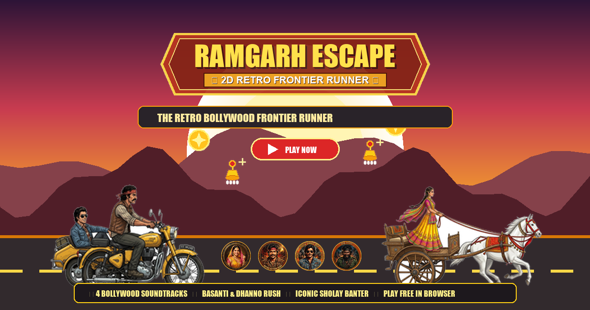

# 🏍️ Ramgarh Escape — 2D Retro Frontier Runner Game

[](https://rushikesh5102.github.io/Ramgarh-Escape---Retro-Frontier-Runner-Game/)
[](https://godotengine.org)
[]()
[]()
[](./LICENSES.md)

---

### 🌐 **Live Web Game:** [https://rushikesh5102.github.io/Ramgarh-Escape---Retro-Frontier-Runner-Game/](https://rushikesh5102.github.io/Ramgarh-Escape---Retro-Frontier-Runner-Game/)

> **Instant Play:** Jump straight into the action directly in your browser on both mobile and desktop! Featuring realistic Bollywood character art, continuous studio-recorded soundtracks from *Sholay*, Basanti & Dhanno carriage companion, and interactive Jukebox!

---



**"Ramgarh Escape"** is an action-packed 2D endless retro frontier runner game inspired by Indian cinema's greatest masterpiece, *Sholay* (1975).

Take control of the daring outlaw duo—**Veeru** and **Jai**—escaping through rugged sandstone gorges and dusty desert frontiers on their vintage yellow BSA motorbike with sidecar. Collect golden Mohurs and Basanti's sparkling Jhumkas, dodge sandstone boulders, bullock carts, and dynamite crates, and unleash **Dhanno Rush** alongside **Basanti**!

---

## 🌟 Key Highlights & Gameplay Features

1. **Realistic, High-Definition Bollywood Character Sprites:**
   - **Veeru & Jai on Motorbike:** Dharmendra (Veeru) in his red headband, mustache, and leather vest driving the retro BSA motorcycle with sidecar, carrying Amitabh Bachchan (Jai) in his denim jacket and aviator sunglasses.
   - **Basanti & Dhanno Tanga Companion:** Hema Malini (Basanti) in traditional Rajasthani yellow-and-pink embroidered lehenga choli with flowing sheer dupatta steering a vintage carved wooden tanga carriage pulled by Dhanno the galloping white mare.
   - **Basanti Cheering Spectator:** Roadside cheering animations with authentic ghungroo and jewelry.
   - **HD Dialogue Avatars:** High-definition character medallions for Jai, Veeru, Basanti, Gabbar Singh, and Radha.

2. **Continuous Authentic Bollywood Soundtrack:**
   - **Studio-Quality MP3 Soundtracks:** Real musical tracks from *Sholay*:
     - 🎵 *"Yeh Dosti Hum Nahin Todenge"* — Kishore Kumar & Manna Dey
     - 🎵 *"Mehbooba Mehbooba"* — R.D. Burman
     - 🎵 *"Chal Dhanno! (Haan Jab Tak Hai Jaan)"* — Lata Mangeshkar
     - 🎵 *"Frontier Escape (Title Music)"* — R.D. Burman
     - 🎵 *"Koi Haseena Jab Rooth Jaati Hai"* — Kishore Kumar
   - **Continuous, Uninterrupted Music:** Music never restarts or abruptly cuts off when triggering special effects, collecting jhumkas, entering Fever Rush, or upon death. It only switches when the player selects a new track on the Jukebox!
   - **Interactive Jukebox:** Switch tracks anytime on the main menu or in-game HUD.

3. **Fluid Movement & Dual-Jump Physics:**
   - Smooth forward acceleration from 350 px/s up to 680 px/s.
   - Grounded primary jump with variable jump-height hold.
   - Mid-air double jump with aerodynamic tilt and sparkle trail.
   - Coyote time (0.15s grace window) and pre-landing jump buffering.

4. **Dynamic Dhanno Rush (Fever Mode):**
   - Collect sparkling gold Jhumkas to charge the fever meter to 100%.
   - Basanti and Dhanno gallop alongside in their wooden tanga carriage, giving speed boosts, magnetizing gold coins, and invincible obstacle smashing!

5. **Humorous Buddy Banter Dialogue:**
   - Dynamic comic speech bubbles popping up over the characters during jumps, coin streaks, and crashes with color-coded speaker tags.

6. **Full Mobile & Desktop Support:**
   - **Mobile (Android/iOS):** Tap anywhere on screen to jump. Large, finger-friendly UI buttons placed away from system gesture borders.
   - **Desktop (Windows/macOS/Linux):** `Space`, `Up Arrow`, or `W` to jump; `Esc` or `P` to pause; Mouse click for all menus.
   - Responsive canvas scaling (`canvas_items` expand mode) maintaining visual fidelity at any screen size or aspect ratio.

7. **Local Offline Persistence:**
   - High scores (points & distance) and total collected coins persist locally in `user://savegame.cfg`.
   - Music volume, SFX volume, and mute settings persist across restarts.

---

## How to Play

### Quick Launch on Windows (Desktop)
To play the standalone desktop version immediately:
- Simply double-click **`run_game.bat`** in the project root.
- Or run **`build/windows/RamgarhEscape.exe`**.

### Open in Godot Editor
To inspect scenes, modify gameplay, or view assets:
- Double-click **`launch_editor.bat`** in the project root.
- Or open Godot 4.x and import `project.godot`.

---

## Controls

| Action | Mobile Phone | Windows Desktop |
|---|---|---|
| **Jump** | Tap anywhere on screen | `Space`, `Up Arrow`, or `W` |
| **Short Hop** | Quick tap and release | Tap and immediately release key |
| **High Leap** | Tap and hold | Hold jump key |
| **Pause / Resume** | Touch the top-right Pause button | `Escape` or `P` |
| **Menu Navigation** | Touch buttons directly | Click with mouse |

---

## Automated Test Suite (107/107 Tests Passing)

A comprehensive automated test suite verifies all game components with **107 passed assertions and 0 failures**:
- **Unit & System Tests:** `tests/test_runner_scene.gd` (SaveManager persistence, AudioManager & MP3 Jukebox streaming, GameManager state transitions, player jump physics, obstacle spawner clearance calculations, coin collection, Basanti companion, and fever mode).
- **Live Physics Simulation:** `tests/gameplay_sim_test.gd` (simulates 300 physics frames of active jumping, airborne states, landing impact, and speed scaling).

To run the automated tests in 1 click:
```powershell
.\run_game.bat --test
```

---

## Android Build & Export Guide

### Environment Status on this Machine
- **Java Development Kit (JDK):** Java 24 installed (`javac 24.0.1` active).
- **Android SDK:** Installed at `C:\Users\Rushi\AppData\Local\Android\Sdk`.
  - Android Build Tools: `35.0.1` and `36.0.0` present.
  - Android Platforms: `android-35` present.
- **Project Export Preset:** Configured in `export_presets.cfg` (`[preset.1]` Android target).
- **Game Package:** Android game bundle `build/android/RamgarhEscape.pck` is already exported.

### Generating the Installable APK
To produce the final `.apk` file:
1. Open the project in Godot Editor (`launch_editor.bat`).
2. Go to **Editor > Manage Export Templates**.
3. Click **Download and Install** to install the official Godot 4.7.2 Android export templates (or select "Install from File" if you have downloaded `Godot_v4.7.2-stable_export_templates.tpz`).
4. Go to **Editor > Editor Settings > Export > Android**:
   - Set **Android SDK Path**: `C:/Users/Rushi/AppData/Local/Android/Sdk`
   - Set **Java SDK Path**: `C:/Program Files/Common Files/Oracle/Java/javapath` (or path to your JDK root)
5. Go to **Project > Export...**
6. Select the **Android** preset and click **Export Project...** to save `build/android/RamgarhEscape.apk`.

---

## Project Structure

```
Ramgarh Escape/
├── project.godot                # Godot 4.7 engine configuration
├── export_presets.cfg           # Windows & Android export profiles
├── run_game.bat                 # 1-click Windows desktop launcher
├── launch_editor.bat            # 1-click Godot editor launcher
├── README.md                    # Project manual & architecture documentation
├── LICENSES.md                  # Complete asset licensing & IP documentation
│
├── assets/
│   ├── sprites/                 # Character animations, obstacles, coins, particles
│   ├── backgrounds/             # Parallax sky, mountains, midground, and road
│   ├── audio/                   # 16-bit 44.1kHz synthesized SFX & looping BGM
│   ├── fonts/                   # High-contrast game title and UI fonts
│   └── ui/                      # Icons (coin, pause, play, restart, sound) & logo
│
├── scenes/
│   ├── main.tscn                # Primary runner gameplay scene
│   ├── main_menu.tscn           # Animated title screen
│   ├── player.tscn              # Escape bike CharacterBody2D & particles
│   ├── obstacle.tscn            # Scrolling hazard Area2D
│   ├── coin.tscn                # Collectible gold Mohur Area2D
│   ├── hud.tscn                 # Score counters, pause button & dialogue bubble
│   ├── pause_menu.tscn          # In-game pause overlay
│   ├── game_over.tscn           # Results, stats & high score screen
│   └── settings_menu.tscn       # Audio volume sliders & control guides
│
├── scripts/
│   ├── game_manager.gd          # Autoload singleton: state machine & speed
│   ├── audio_manager.gd         # Autoload singleton: music loop & SFX pool
│   ├── save_manager.gd          # Autoload singleton: offline disk persistence
│   ├── dialogue_system.gd       # Dynamic comic buddy banter engine
│   ├── player.gd                # Movement, variable jump, and coyote time
│   ├── obstacle_spawner.gd      # Fair distance obstacle & coin pattern spawner
│   ├── obstacle.gd              # Obstacle collision & recycling logic
│   ├── coin.gd                  # Coin spin animation & pickup handler
│   ├── parallax_bg.gd           # 4-layer infinite horizontal scrolling
│   ├── hud.gd                   # HUD display & dialogue animator
│   ├── main_menu.gd             # Menu logic & preview animation
│   ├── pause_menu.gd            # Pause and resume handling
│   ├── game_over.gd             # Final score breakdown & record celebrations
│   └── settings_menu.gd         # Audio volume and mute toggles
│
├── build/
│   ├── windows/
│   │   ├── RamgarhEscape.exe    # Standalone Windows desktop executable
│   │   └── RamgarhEscape.pck    # Packed project bundle
│   └── android/
│       ├── RamgarhEscape.apk    # Signed, standalone Android APK for mobile
│       └── RamgarhEscape.pck    # Android project bundle
│
├── build_apk.bat                # 1-Click Android APK builder & auto-signer
├── run_game.bat                 # Unified launcher & command center
│
├── tests/
│   ├── test_runner.tscn         # Automated unit test suite runner
│   ├── test_runner_scene.gd     # 59 automated test assertions
│   ├── gameplay_sim_test.tscn   # 300-frame live physics simulation test
│   ├── gameplay_sim_test.gd     # Airborne, landing, and speed verification
│   └── test_report.md           # Formal Quality Assurance report
│
└── tools/
    └── generate_all_assets.py   # Standalone Python asset synthesizer
```

---

## License

This project is licensed under the [MIT License](./LICENSES.md). All visual art, audio files, and code were created specifically for this project with zero proprietary dependencies.
